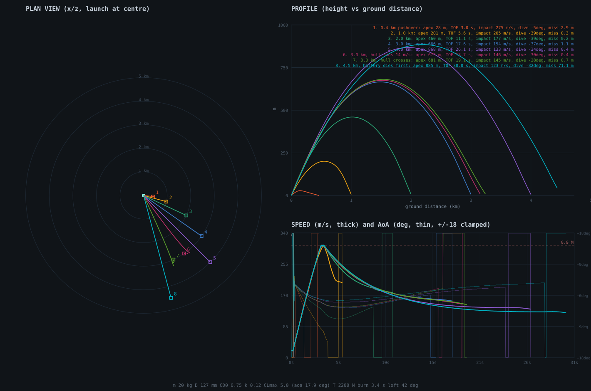

# 攻顶导弹飞行模型重构计划

状态：**已实现**（2026-10-30）。§7 的包线表由 `tools/top_attack_trace.py` 直接调用
`backend/server/flight.py` 跑出来 —— 表里的数就是引擎里的数。
范围：`defs.WEAPONS[WID_TOPATTACK]`、`systems/projectiles.py` 的 `k == 3` 分支、新增的
`flight.py`（气动 + 制导库）、`systems/weapons.py` 的发射仰角、`systems/locking.py` 的锁定
距离（只是数据：`range`）、以及弹丸寿命到期后的自爆。
不改：`kind` 语义、锁定圆圈与导引头脱锁规则、爆炸与伤害、拦截（30mm 近炸 / 雷达）、
经济、AI、弹丸快照协议。

---

## 0. 一句话

把攻顶弹从「恒速纯追逐 + 两段航路点」换成一条**真飞行的滑翔弹**：
火箭发动机按固定仰角把弹推上 200–950 m 的顶点（燃尽时刚好 0.9 M），之后**无动力滑翔**，
靠升力与阻力自己把高度换成射程，最后一段**比例导引**砸向车顶；近距发射时制导指令
迫使弹**负攻角压机头**俯冲，这份阻力由气动极曲线如实收账。**电池 30 s，到期立刻自爆；
锁定距离 4 km；实用包线 2–4 km。**



（左：俯视航迹；右上：高度/水平距离剖面；右下：速度与攻角。这张图由 §9 的
`tools/top_attack_trace.py` 生成，数值改动后重新跑即可。）

---

## 1. 目标与非目标

### 目标

1. **像一枚弹，而不是一条曲线**。弹有质量、有攻角、有升力、有阻力、有重力：
   同一条弹道既能爬升也能俯冲，能量从发动机来，花在爬升、阻力和转弯上。
2. **每一条设计意图都落到一个物理量上**：
   - 最高速度 = 0.9 M（`maxvel = 306 m/s`，发动机按燃尽速度标定，硬上限兜底）；
   - 动力段按稳定仰角爬升（`loft`，管子本身抬到 42°）；
   - 爬到尽量高（顶点 `Hmax` 950 m，随射程线性长到上限）；
   - 巡航 / 俯冲无动力（燃尽后 `T = 0`，只有升力、阻力、重力）；
   - 阻力随攻角与速度变（`CD = CD0 + k·CL² + 跨音速`）；
   - 近距发射强行负攻角俯冲（制导指令压制机头，攻角钳在 −17.9°，阻力同时暴涨）。
3. **制导分段与用户给的规则一致**：爬升/巡航段**水平纯追逐**（瞄目标当前方位，不提前量），
   末段**比例导引**（N = 4，对车顶解算，水平与垂直两个平面同时）；
   一旦相对目标的**攻击角**达标就进入末段 —— 近距发射时这个条件是起射瞬间就成立的。
4. **包线可解释**：2–4 km 打得住，4.5 km 起电池撑不到，跑靶比静靶少 500 m 左右。
5. **不动协议**：飞行状态全部由 `pos` / `vel` / `proj_age` + `defs` 常数推出来，
   **不加组件、不换 archetype、不改快照**（§5.1）。
6. **确定性**：新模型不用 `world.rng`，同一 tick 状态永远给同一个加速度，
   `tools/replay.py` 只需重标基线，不需要新的顺序约束。

### 非目标

- 不改 `kind` 语义（仍是 `"top"`，仍属于 `INTERCEPT_KINDS`，仍可被 30mm 近炸打下来）。
- 不给其他弹种加气动：SACLOS 的「推力 + 二次阻力 + 抖振」、S-8 的火箭、子弹的弹道都不动。
- 不改锁定圆圈的几何（`LOCK_FRAC`、`lock_time`、脱锁即清零），只把**距离门限**从 2.5 km 放到 4 km。
- 不改爆炸与伤害数值（`ed 60 / er 7 m`、`ap 900 / ad 120`）。
- 不做客户端模型改造：弹丸仍按 `pos` + `vel` 插值画，不需要把机头姿态发下去。
- 不做 AI 发射（现在也发不了：`lock` 武器只有玩家能扣扳机，见 §8）。

---

## 2. 现在的模型，和它为什么留不住

`systems/projectiles.py` 的 `k == 3` 分支（约 40 行）：

- 速度：`min(maxvel, v + thrust·dt)`，**恒速 190 m/s，无重力、无阻力、无过载限制**；
- 航路点：水平距离 > 220 m 时瞄「自身与目标之间 35% 处、目标高度 +150 m」的一点，
  否则瞄车顶；`_steer` 以 **1.9 rad/s 恒定角速度**转向，与空速无关；
- 脱锁 / 目标死亡 → 归一化速度 + 9.81 重力（一个抛体）。
  （这一条是**旧模型**的行为；脱锁后的姿态后来改过，见 §10-4 与
  [top_attack_relock.md](top_attack_relock.md)。）

结果：射程只由 `life` 决定（52.6 s × 190 m/s ≈ 10 km），弹道是一条三段折线
（45° 爬升 → 平飞 → 34° 俯冲），**没有能量守恒**，也就没有「打远了打不动」这回事，
近距发射也不存在任何代价。

---

## 3. 新模型：状态、力、积分

### 3.1 状态

弹丸实体已有的组件就是全部状态：

| 状态 | 来源 | 含义 |
| --- | --- | --- |
| `pos` | 已有 | 世界坐标 |
| `vel` | 已有 | 空速矢量（大小 = 空速 V，方向 = 弹道倾角） |
| `proj_age` | 已有 | 飞行时间 → 发动机已烧了多久、电池用了多久 |
| `target` | 已有 | 导引头锁的目标（`-1` = 无锁） |
| `tgt_mem` / `tgt_vel` | **新** | 凝视点与目标最后速度（复锁用，见 `top_attack_relock.md`） |
| `proj_wid` | 已有 | 取 `defs.WEAPONS[wid]` 的全部气动常数 |

**没有气动状态组件。** 攻角 α、升力方向、机头指向都是每个 tick 从 `vel` + 制导指令算出来的
导出量，所以 archetype 不变、快照不变、`ecs` 的「组件集就是类型」不变。
（飞行模型落地之后加的那两个组件不属于气动：它们是**导引头的记忆**，只活在导弹原型上。）

### 3.2 每个 tick 的力

```
V   = |v|                      空速               (m/s)
q   = ½·ρ·V²                   动压, ρ = 1.225    (Pa)   高度 < 1 km，不做密度修正
n̂   = 机头 = v̂ 绕升力方向转 α
T   = thrust·m  (age > ignite 且 burn 未烧完 且 V < maxvel)   N，沿 n̂
L   = q·S·CL                   升力，垂直 v̂       N
D   = q·S·CD                   阻力，反向 v̂       N
CD  = CD0 + k·CL² + 0.4·max(0, M − 0.8)²                （M = V/340，跨音速抬升）
CL  = m·a_cmd / (q·S)  ≤ CLmax                          （制导要多少升力）
α   = CL / CLα   ×(升力在哪一侧)                         （±17.9° 钳位）
a   = (T·n̂ − D·v̂)/m + (q·S·CL/m)·L̂ + (0, −9.81, 0)
v  += a·dt ;  pos += v·dt                                （一阶欧拉，dt = 1/30）
```

要点：

- **升力由制导指令反解，不预设升力系数**：制导说「要往这边拐 a_cmd」，
  `CL = m·a_cmd/(qS)` 就是需要的升力系数，超过 `CLmax` 就削到 `CLmax`
  —— 高速能拉、低速拉不动是自然结果（250 m/s 时 12.4 g，150 m/s 时 4.5 g）。
- **攻角是机头相对速度的角**（`α = CL/CLα`），机头偏出去多少，推力就偏多少：
  所以拉起时推力帮着拐，压机头时推力把弹头往下按 —— 近距那一下「强行负攻角」就是这么来的。
- **阻力极曲线是对称的**（`k·CL²` 只用平方），所以一次负攻角的压杆和一次正攻角的拉升
  付出同样的代价：`|CL| = 5` 时 `CD = 0.75 + 3.0 = 3.75`，是干净飞行（`CD 0.75`）的 **5 倍**。
- **重力和阻力都在账上**，而且不便宜：这条极曲线的最优滑翔比只有 `L/D = 1.67`
  （`CL = √(CD0/k) = 2.5`，约 9° 攻角），所以「拿高度换射程」换不出多少 ——
  4 km 的射程主要是 0.9 M 的**动量**撑起来的，弧只是把它安排成一条能落点的曲线；
  一次 12 g 的末段拉杆会瞬间吃掉 90–120 m/s² 的速度（§7.3 实测）。

### 3.3 停机条件（真会掉下来的几种情况）

- **速度归零**：`q → 0` 时升力归零，弹变成一块铁往下掉（不再有恒速魔法）。
- **脱锁**：`target = -1`，但制导**不关**——导弹按目标最后位置与最后速度算出的点继续飞，
  弹道形状、俯冲段全部照旧，并在那个点周围 3° 内自动复锁（`seeker.py`，
  [top_attack_relock.md](top_attack_relock.md)；`sight.py` 挡住视线时仍然写日志、仍然
  `emit("seeker")`，规则一字不改）。只有**从来没锁过**的弹才是 `CL = 0` 的一块铁。
- **电池到期**：`age ≥ life` → 就地引爆（§5.4）。

---

## 4. 制导：三段 + 末制导

### 4.1 参考弧（弹道形状）

射程 `R0` 在**发射瞬间冻结**，参考高度是一条抛物线：

```
u       = r / R0                        r = 当前水平剩余距离
H       = max(0.045·R0, min(Hmax, κ·R0, R0² / (8·R_turn)))     顶点
h_ref(r)= y_roof + H·4u(1−u)                                  参考高度
升力方向 = atan(−dh/dr) + K_h·atan2(h_ref − y, max(r, 60))      爬升/下滑指令（±1.2 rad 钳位）
水平方向 = 目标当前方位的纯追逐（不提前量）
```

- `κ = tan(loft)/4 = 0.225`：**弧的起射角正好等于管子仰角 42°**，所以「动力段按稳定角度爬升」
  与「弧」在远射上是同一件事；近射时弧要求的角度更浅，制导就把弹压下去（§4.4）。
- `R0²/(8·R_turn)`：抛物线的顶点曲率半径是 `R0²/(8H)`，压到空速能转出来的半径（700 m）以上 ——
  500 m 的近射不可能有 300 m 的顶点，物理不允许，模型也不假装允许。
- `0.045·R0`：最低顶点，保证发射后推力有余量把弹推离地面（推重比 11.2，
  仰角低于 6° 时 `T·sinγ < mg`，弹会往下沉）。低于 ~250 m 时两个约束打架，取净空那一侧。
- **「攻击角」不是第三个旋钮**：弧在终点的斜率是 `−atan(4H/R0)`，长射程下 = `−loft`，
  所以爬升角和俯冲角是同一个数（42°），实测末段 35–42°（弯不过来时略浅）。
  一个数同时管起射姿态和落角，调参只有一处。

**和「固定仰角爬升、到达攻击角就俯冲」的关系**：动力段确实按**稳定仰角**爬升
（弧的起射斜率 = 管子仰角 42°，两者是同一个数），近距发射也确实在**攻击角一达标就压下去**。
变的是「达标」的判据：如果按纯几何条件（视线俯角 ≥ 攻击角）才切末段，切换点会太晚 ——
42° 爬升在 306 m/s 下转弯半径 700 m 以上，从 +42° 压到 −40° 需要 **0.9 s 以上、200 m 以上的弧长**，
而那时弹已经离目标不到 300 m 了。早期版本（固定仰角 + 几何触发）实测 **2–3 km 的射击普遍过顶
100–500 m 打飞**，就是这个滞后。
参考弧的作用只是**把这个转弯提前摊到整个飞行上**：俯冲不是一次转身，而是弧的后半段，
于是「到了攻击角」时弹的速度方向本来就在那个角度上，末段 PN 只做微调。
末段倾角因此自然收敛到 35–42°（§7），而不是靠限幅硬拧出来。

### 4.2 三段

| 段 | 条件 | 指令 |
| --- | --- | --- |
| **动力爬升** | `age < ignite + burn` | 参考弧的仰角，且**不超过管子仰角 `loft` 42°**；推力沿机头 |
| **滑翔** | 燃尽后、末段前 | 参考弧的仰角；`T = 0`，只有升力/阻力/重力 |
| **末制导** | `r < pn_r`（300 m）且 `V > pn_v`（120 m/s） | 真比例导引（§4.3） |

`pn_v` 的意义：动压太小时导引指令没有意义（20 m/s 起射的一瞬间 `qS = 0.16 N`），
所以末段必须等弹有了速度才接；这也是近距发射时「压机头」能真的压下来的原因 ——
先靠推力与升力把速度做起来，再压。

### 4.3 末制导：比例导引

瞄准点是**车顶** `y_roof = 目标 y + 0.92·hull_height`（机甲 5.98 m，APC 2.58 m），
真 PN（两个平面同时在解）：

```
r     = 车顶 − 弹位置        v_rel = 目标速度 − 弹速度
Ω     = (r × v_rel)/|r|²    视线角速度
Vc    = −r̂·v_rel            接近速度
a_cmd = N·Vc·(Ω × r̂)        N = 4
a_cmd ⊥ v̂ 分量取用，|a| 再受 q·S·CLmax/m 钳位
```

水平纯追逐 + 末段 PN 的分工与用户给的规则一致：**远处瞄的是目标本身（无提前量），
最后 300 m 才按视线角速度解提前量**。对 14 m/s 的机甲无差别目标实测脱靶 0.4–2 m（§7.2）。

### 4.4 近距发射：强行负攻角

管子固定在 **42°**，参考弧给近距射击的指令只有十几度甚至负 —— 制导于是要求**向下的升力**，
`α` 变成负值，机头被压到速度线下方，推力把弹往地面按：

- 300–400 m 射击：起射后头 0.43 s `α` 一直贴着 **−17.9°**（`CLmax/CLα` 的钳位），
  弹道倾角从 38.6° 掉到 20° 以下；
- 同一时刻 `CD = 0.75 + 0.12·25 = 3.75`，阻力是干净飞行的 5 倍 ——
  **这就是「也要计算相应的阻力」**：压机头的速度代价是真的，不是装饰；
- 结果：400 m 的目标 2.8 s 内被打中，而 4 km 的目标要 26 s —— 同一枚弹，两种完全不同的飞行。

---

## 5. 数据与实现落点

### 5.1 `defs.WEAPONS[WID_TOPATTACK]`

删掉 `climb` / `cruise` / `dive`（航路点模型的残留），换成一套气动与制导常数：

```python
dict(wid=WID_TOPATTACK, key="topattack", name="TOP-ATTACK IR ATGM", kind="top",
     ap=900, ad=120, ed=60, er=7.0,                  # 战斗部不动
     rpm=120, mag=4, reserve=0, reload=0.0,          # 四根管子四发，无弹匣无换弹（§5.7）
     vel=20,                                          # 软发射出管速度（不变）
     mass=20.0, dia=0.127,                            # S = π(d/2)² = 0.0127 m²
     cd0=0.75, k_cl=0.12,                             # 阻力极曲线
     cl_alpha=16.0, cl_max=5.0,                       # α ∈ ±17.9°
     thrust=110.0,                                    # m/s²，和其他武器同一个量纲（= 2200 N / 20 kg）
     burn=3.4, ignite=0.15,                           # 点火延迟 + 燃烧时长，燃尽正好 0.90 M
     maxvel=306.0,                                    # 0.9 M 硬上限（沿用旧键，含义不变）
     loft=0.733,                                      # 42° 管仰角
     apex=950.0, turn_r=700.0,                        # 顶点上限 / 最小转弯半径
     pn_n=4.0, pn_r=300.0, pn_v=120.0,                # 末制导
     life=30.0,                                       # 电池：到期自爆
     range=4000,                                      # 锁定距离（↑ 从 2500）
     spread=0.002, bias=0.0, lock=1, lock_time=1.1,
     rack=RACK_TOP,                                   # 2 x 2 贯通式发射架（§5.7）
     salvo=0, semi=0, color=(1.0, 0.35, 0.9), cal=127, rcs=0.02,
     desc="4 km lock-on, fire and forget")
```

`cost` / `ammo_cost` 一类价格数**不在这次改动里定**（见 §10 开放问题 1）。

### 5.2 新文件 `backend/server/flight.py`

一个库，不是系统（和 `ballistics.py` / `combat.py` / `shop.py` 同级）：

```python
def step(world, pid, dt) -> tuple[float, float, float]:
    """This tick's airframe + guidance for one round: returns the new velocity."""
```

内部三个纯函数，好读也好测：

```
_arc(r, r0, wd)        -> 参考高度与仰角指令
_pursuit(v, want)      -> 升力方向与大小（纯追逐 / PN 共用一个转向入口）
_aero(v, a_want, wd, dt, T) -> 升力/阻力/推力算出来的加速度
```

`projectiles.run` 的 `k == 3` 分支缩成：导引头视线检查（保留原样）→
`vel[pid] = flight.step(...)` → 电池到期的自爆判断。

### 5.3 `systems/weapons.py`：出管仰角

`kind in (2, 3)` 现在统一 `pitch = max(pitch, 0.18)`。改成：

```python
if kind == 3:
    pitch = float(wd["loft"])       # 管子自己抬到 42°，锁上就打，不用玩家抬枪
elif kind == 2:
    pitch = max(pitch, 0.18)        # SACLOS 不变
```

于是「动力段按稳定角度爬升」不需要任何飞行控制去争取：管子就是那个角度，
飞行员压不压枪都不影响弹的起射姿态（already fire-and-forget）。

> 后来这一步收敛进了发射架本身的描述（`defs.rack` 的 `elev` / `bolted`）：
> 攻顶架 `bolted` 恒在 42°，SACLOS 架在手臂瞄准方向之上加 0.18 rad，
> 平装的火箭巢完全跟随手臂。`weapons.fire` 现在只问发射架怎么挂，不再按
> `kind` 分支——见 `AGENTS.md` 的 "a launcher of tubes is described once"。

### 5.4 电池：30 s 到期立刻引爆

- `defs.life = 30.0`（现在 52.6）；
- `projectiles.run` 里 `life <= 0` 的分支，对 `kind == 3` 改成
  `impact(world, pos, wd, pid)`（和 SACLOS 断线 `maxdist` 到期同一套），
  **不是静默 `destroy`** —— 战斗部在空中炸开，`ed 60 / er 7 m` 的爆炸照常结算，
  己方不豁免（`blast_friendly=False`，因为这不是炮口自伤而是战斗部起爆）；
- 客户端不用改：爆炸是 `blasts.spawn` 的实体，客户端照常画。

### 5.5 锁定的距离门限

`locking.run` 用 `dist < wd["range"]` 卡锁定距离，所以把 `range` 从 2500 改成 **4000**
就是「允许锁定 4 km 的目标」。同一字段还会被客户端换装面板当作「射程」显示（`screens.md`），
所以玩家看到的就是 4.0 km。

### 5.6 不动的部分

- `components.py`：一行不改。
- `netcode.py`：`PROJ_DTYPE` 一行不改（客户端从 `vx/vy/vz` 就能画弹道与拖尾）。
- `blasts.py` / `combat.py` / `mortality.py`：一行不改。
- `systems/proximity.py` / 雷达 / RWR：一行不改 —— 但**数字会变**（§7.4）。

### 5.7 发射架与弹匣（2026-10-30 追加）

原来攻顶弹跟 SACLOS 共用一套「弹匣 2 + 备弹 8 + 换弹 4.6 s」，手臂上却画着一个
和火箭巢不一样的方盒。改成**四根管子、一根一发**之后，它和火箭巢共用**同一个机制**：

```python
RACK_TOP = rack(2, 4, 8, bore=0.24, pitch=0.28, length=1.70, centre=0.0, end=0.25,
                frame=0.025, elev=0.73299)
# -> {cols: 2, rows: 4, count: 8, pitch: 0.28, mouth: 0.85,
#     box_len: 1.20, box_w: 0.57, box_h: 1.13}
```

**尺寸是临时放大值**：机体模型当初没按挂在它身上的武器反推过尺寸，一个真实比例
（0.20 × 1.40 m）的发射架摆上去像玩具，×2 又大得像压住整台机甲，折中在 **1.2 倍**
（0.24 × 1.70 m），并排成 2 列 × 4 行（八发）。格距按**火箭巢的比例**取（管巢是
0.155 / 0.135 = 1.15 个管径），这里 0.28 / 0.24 同样是 1.17，所以正面是一面干净的蜂窝
而不是"八个点摊在空盒子里"；铁盒子只是 0.025 m 的一圈边，正面余量正好 10% 管径。用
"管间留一整圈空隙"的排法（格距是管径的 1.5 倍、边框 0.24）架体会胖到 1.48 m、内侧
坐进躯干 0.17 m，正面还是一片空。等机体重做后，把这组数折到真实直径即可。

- `defs.rack(...)` 是**一件发射管的唯一描述**：格子（列/行/发数）、管径、管长、格距、
  架体尺寸、管口位置。`rack_tube(fired, spec)` 给出第 n 发从哪一格出去
  （**最下面一排先空、从左到右**）。服务器用它算**出膛点**，客户端用它画**同一个模型**
  —— 一次描述，两边都读，不许各写一份。
- `systems/weapons.py:fire` 的炮口距离优先序是 `wd["reach"]`（炮自己的长度）→
  `rack["mouth"]`（管口）→ `MECH_ARM_REACH[kind]`（同类型默认值）。有 `rack` 的武器
  不用再往 `MECH_ARM_REACH` 里加条目。
- 弹药就是管数：`rpm 120`（0.5 s 一发）、`mag 8`、`reserve 0`、`reload 0.0`。
  `weapons.run` 在 `mag == 0 且 ammo == 0` 时什么也不做，所以打完**不会**上膛——
  回基地买一套新的（`cost 700 + 4 × ammo_cost 45 = $880`）。
- 客户端 `scene.js` 的 `rack()` 按同一份 spec 画架体和全部六边形管：架体比管子两端
  各短 `end` 米，所以管子**前后都露头**（贯通式，从车头也能从车尾看到管口），
  打空的格子画成暗色。带 `rack` 的手臂不再画通用炮架壳体与肩球——那两件会把管口
  整个包住（这正是第一版从后面看不见管子的原因）；连杆改成从手臂转轴处直出、加长
  插进架体，接点落在架体侧面的正中心。
- 发射架**固定在自己的 42° 象限**上（`rack["elev"]`）：手臂怎么俯仰都不动它，服务器
  用它算**出膛点**，客户端用同一个数画管子——所以导弹出去的方向就是画出来的管口方向。
  火箭巢 `elev = 0`，仍然跟着手臂转。
- `RACK_ROCKET`（5 × 8，40 发）走的是同一条代码路径，只是它有自己显式的架体尺寸；
  顺手修掉了一个老 bug：`scene.js` 把架体的**宽和高画反了**（`box_w` 填进了竖直轴），
  5 列 8 行的火箭巢因此被画成 1.26 m 宽、0.82 m 高，横着躺。

---

## 6. 客户端

不需要改。弹丸仍按快照插值绘制；新弹道的观感变化是自动的：

- 弹会**真的爬到 200–950 m 再扎下来**，从瞄准镜里看是一道很高的弧；
- 尾迹方向来自 `vel`，所以爬升/俯冲的折线会自然画出来；
- `boom` / `seeker` / 拦截特效都不变；
- 只有中间那 26 s（4 km 射击）飞得比过去久，屏幕上空会一直有一条弹道 —— 这是设计意图。

---

## 7. 实测包线（离线模型，30 Hz，静靶 / 跑靶）

标定方法：把 §3/§4 的模型按 1/30 s 逐 tick 积分，机甲 6.5 m、车顶取 5.98 m，
射程从 100 m 扫到 5 km，静靶与 14 m/s 直线跑靶各跑一遍。图见
`doc/design/ref/top_attack_profile.svg`。

### 7.1 静靶（车不动）

| 射程 | 顶点 | 飞行时间 | 命中速度 | 末段倾角 | 脱靶 |
| --- | --- | --- | --- | --- | --- |
| 0.4 km | 28 m | 3.0 s | 275 m/s | −5° | 2.9 m（近炸半径 7 m 内，算命中） |
| 1.0 km | 201 m | 5.6 s | 205 m/s | −39° | 0.3 m |
| 2.0 km | 460 m | 11.0 s | 178 m/s | −39° | 0.8 m |
| 3.0 km | 666 m | 17.6 s | 154 m/s | −37° | 1.1 m |
| 4.0 km | 868 m | 26.1 s | 133 m/s | −34° | 0.3 m |
| 4.3 km | 883 m | 28.7 s | 126 m/s | −32° | 1.2 m |
| 4.5 km | 885 m | 30.0 s | — | — | **电池到期，空中自爆于目标前 83 m** |
| 5.0 km | 890 m | 30.0 s | — | — | 电池到期，自爆于 670 m 外 |

### 7.2 跑靶（机甲 14 m/s 直线）

| 射程 | 脱靶（跑） | 脱靶（横穿） |
| --- | --- | --- |
| 1.0 km | 0.3 m | 1.1 m |
| 2.0 km | 0.3 m | 1.1 m |
| 3.0 km | 2.0 m | 0.7 m |
| 3.5 km | 1.9 m | 0.4 m |
| 4.0 km | **14 m MISS（电池差半秒）** | 0.5 m |
| 4.3 km | 电池先到 | 电池先到 |

**结论**：静靶 2–4.3 km 稳定命中；会跑的车 2–3.5 km 稳定命中，4 km 开始靠不住
（横穿还行，逃跑就打不到了）。这就是「2–4 km 的武器」：**射程上限不是发动机，是 30 s 电池。**

（顶点比离线草稿低 40–60 m：实现里参考弧的 `R0` 是「已飞航程 + 剩余距离」，
比发射瞬间的直线距离略长，弧因此更平一点 —— 飞行时间、落速、脱靶都在同一档。）

### 7.3 发动机与能量（旁证）

- 峰值空速 **306 m/s（0.90 M）**，出现在燃尽瞬间 t ≈ 3.5 s（0.15 s 点火延迟 + 3.4 s 燃烧）；
- 燃尽后靠高度换射程：4 km 的射击在 26 s 里把 868 m 高度和 306→133 m/s 的速度一起花掉；
- 末段 12 g 拉杆的减速实测 **90–120 m/s²**（`CD` 从 0.75 涨到 3.75 的那一下）；
- 全飞行 `α ∈ [−17.9°, +17.9°]`，两个方向都撞到钳位（近距压机头、末段拉杆）。

### 7.4 连带变化的数字（产品文档要跟着改）

- **雷达发现距离**：`d² = K·v_c`，速度从 190 → 306 m/s，机甲雷达对它的发现距离
  **563 m → 714 m**，预警时间 **2.96 s → 2.33 s**（`defs.radar_k`，公式不动，只有 v 变）；
- **拦截**：`tools/intercept_check.py` 实测 **攻顶 8 发 8 落**（900 m 与 1400 m 各
  4 发，引信距离 2.3–3.4 m），全套仍是 32 发里 30 发。也就是说飞得更高更快**并没有**
  让 30mm 防御更难 —— AI 的 `solve_lead` 会算竖直速度，爬升段反而更容易提前量；
  真正被削弱的是大地图上的 RWR 预警时间（2.96 s → 2.33 s）；
- **锁定距离**：2.5 km → 4.0 km（`range`）；
- **飞行时间**：2 km 从 12 s 变成 11.0 s（差不多），4 km 变成 26 s（过去 21 s）。

---

## 8. 与现有系统的关系

| 系统 | 还成立吗 | 说明 |
| --- | --- | --- |
| 导引头（`locking.py`） | 是 | 圆圈、`lock_time`、脱锁清零不动；只有 `range` 4 km |
| 视线规则（`sight.py`） | 是 | 飞行中脱锁 → `target = -1` → 按记忆继续飞并在 3° 内复锁（§3.3）。爬得高以后地形遮挡变少、烟幕遮挡照旧 |
| 拦截（30mm 近炸 / `proximity.py`） | 是 | 3D 扫掠与近炸都用 `pos`/`vel`，新弹道照样能被炸；难度上升（§7.4） |
| 雷达 / RWR | 是 | 公式不变，只是 v 变大 → 看得更远、预警更短 |
| 伤害 / 爆炸 | 是 | 战斗部与 `impact()` 不动 |
| 电池 | **新** | 30 s 到期 `impact()` 自爆（§5.4） |
| AI 反导（`ai._missile_step`） | 是 | 攻顶弹问导引头 `target` 判「冲我来」，断锁后按凝视点 100 m 内判（`CPA_MEM`），与新弹道无关 |
| AI 发射 | 否（与现在一致） | `lock` 武器只有玩家能发；`ai._aim_and_fire` 也只触发 `rocket`/`saclos` 二号臂 |
| `tools/replay.py` | 需重标 | 战斗里双方 AI 的火箭/导弹都在，弹道变了要 `--save` |
| 确定性 | 是 | 新模型无随机数；仍按 `pids` 升序逐发积分 |

---

## 9. 落地步骤与验证

### 9.1 工具（先写工具，再动弹道）

`tools/top_attack_trace.py`（新，仿 `raid_trace.py` / `vehicle_trace.py`）：

- 不启动服务器，直接 import `flight`，把 §3/§4 的模型逐 tick 积分；
- 扫射程 0.1–5 km × {静靶, 逃靶, 横穿靶}，打印 §7 的两张表；
- 写 `doc/design/ref/top_attack_profile.svg`（俯视 + 剖面 + 速度/攻角三块，和本文那张同源）；
- 断言：峰值空速 ≤ 0.9 M（306 m/s）、静靶 1–4.3 km 脱靶 < 3 m、4.5 km 必自爆、近距 300–400 m 起射后 0.5 s 内 `α` 触到 −17.9°。

### 9.2 落地顺序（已完成 1–4）

1. ✅ `flight.py` + `defs` 新字段 + `projectiles` 接线 + `weapons.py` 仰角。
2. ✅ 电池自爆 + `range = 4000`。
3. ✅ `tools/replay.py` **无需重标**（脚本战斗里没有攻顶弹：玩家默认装的是机炮+火箭巢，
   AI 又不扣 `lock` 武器的扳机），900 tick 逐位一致；`tools/gunnery_check.py` 全过。
4. ✅ `tools/intercept_check.py`：攻顶 8/8 被拦，全套 30/32 不变。
5. ⬜ 战斗模式实战验收：2–4 km 打 AI 机甲、对着坡后目标断锁、对着逃靶看电池自爆。

### 9.3 文档义务（同一次提交）

- ✅ `doc/product/weapons.md`：第 5 行的参数表（射程 4000、速度 0.9 M、电池 30 s），
  以及「攻顶弹道」那一节整段重写（现在的 150 m 爬升 / 220 m 转俯冲 / 34° 俯冲全部作废），
  拦截表里的发现距离与预警时间（563 m / 2.96 s → 714 m / 2.33 s）；
- `doc/product/screens.md` §2.10：锁定距离 4 km（圆圈几何不变）；
- `doc/product/units.md`：凡引用攻顶弹道/拦截数字的地方（烟幕脱锁那段行为不变，数字同步）；
- `doc/product/range.md`：拦截一节的实测数字（等 §9.2-4 的结果）；
- `doc/product/CHANGELOG.md`：顶部加一条带日期的条目。

---

## 10. 开放问题（要先定的数）

1. **价格**：4 km、0.9 M、一发必杀，`cost 700 / ammo 45` 明显偏便宜。
   建议 `cost 900 / ammo 60`（对齐 105mm 的一发 $60 弹药），但这是策划决定，写在 `defs` 里。
2. **电池 30 s 与 4 km 的余量**：4 km 静靶 26.1 s，只剩 3.9 s；跑靶 4 km（逃跑）差半秒，会自爆。
   如果想「4 km 打逃靶也稳」，两条路：电池 34 s，或把 4 km 的顶点削到 800 m（省能量换速度）。
3. **近射段**：<250 m 时净空约束与转弯半径约束打架（§4.1），现在是净空优先 ——
   表现是「管子抬 42°、压下来打平射」。是否要给它一个单独的近距模式（低伸平飞）？
4. ~~**脱锁后的姿态**：脱锁即 `CL = 0`（一块铁）。~~ **已解决**：导弹记住目标最后位置与
   速度，脱锁后照常飞、3° 内自动复锁，见 [top_attack_relock.md](top_attack_relock.md)。
5. **AI 能不能发射**：如果希望蓝方 AI 打攻顶，需要在 `ai._aim_and_fire` 里给它一个
   「AI 锁定」（当前目标）并绕过 `weapons.run` 的玩家锁定检查 —— 这是一条独立的设计线。
